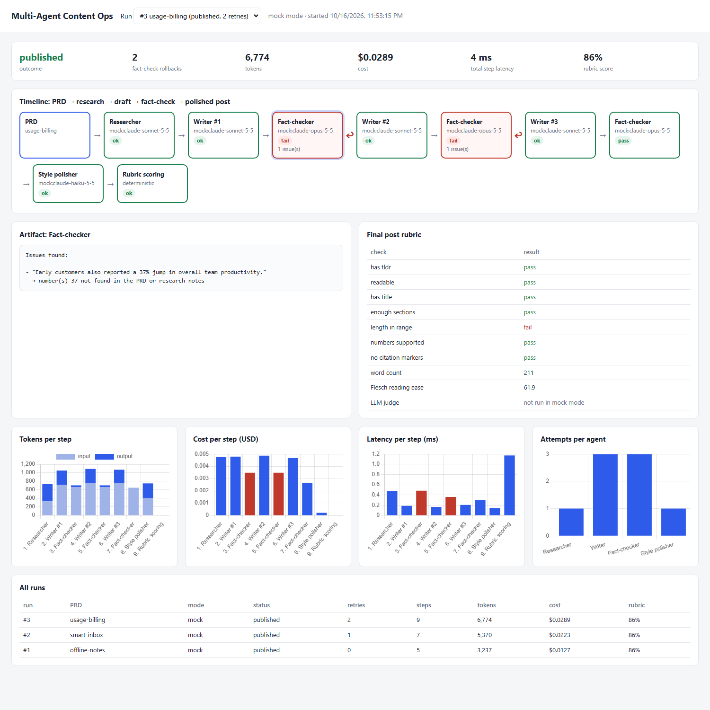
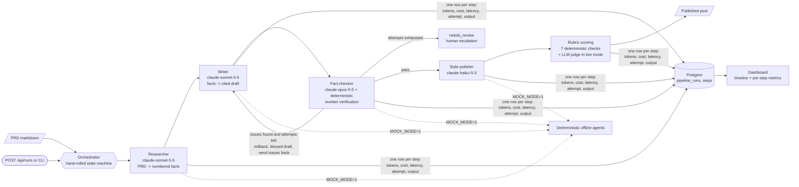

# Multi-Agent Content Ops

**Four AI agents turn a product spec into a fact-checked blog post. Failed fact-checks automatically roll back and rewrite, and every step is logged.**

[](https://github.com/liorva22/multi-agent-content-ops/actions/workflows/ci.yml)
[](LICENSE)


## Demo



*A real run: `docker compose up` (the `seed` service pushes three example PRDs through the pipeline into Postgres), then a headless-Chrome screenshot.*
- *The timeline shows the usage-billing PRD: the fact-checker rejected two drafts for an invented "37%" statistic (red), and the writer rolled back twice before the post passed.*
- *Click any step to see its artifact.*
- *Below the timeline: the rubric, plus tokens, cost, and latency per step and attempts per agent.*

## The problem

Launch posts written from a product spec are slow to produce and risky to publish: one invented number ("customers saw a 37% productivity boost") becomes a public, wrong claim. This pipeline splits the job between specialized agents and puts a fact-checker in the loop that can send a draft back. It also keeps a step-by-step record of who produced what and what it cost.

## Architecture



1. **Researcher** extracts every checkable fact from the PRD as `F1…Fn`, each with its source section.
2. **Writer** drafts a Markdown post using only those facts, citing `[F#]` after each sentence.
3. **Fact-checker** runs Opus's review plus a deterministic check that every number in the draft exists in the PRD or the facts. Any issue means a **rollback**: the draft is discarded, the research is kept, and the writer retries with the issues attached. After `max_write_attempts` (3), the run becomes `needs_review`.
4. **Style polisher** strips citations, adds a `**TL;DR:**`, and applies the style guide without touching facts.
5. **Rubric** runs seven deterministic checks: title, TL;DR, ≥3 sections, 250–1000 words, no leftover citations, all numbers supported, and Flesch reading ease ≥ 30. In live mode, an LLM judge also scores clarity, accuracy, and engagement.

Orchestration is a hand-rolled state machine, not LangGraph. The reasoning is in [DECISIONS.md](docs/DECISIONS.md#design-decisions).

## Key results

From `MOCK_MODE=1 python -m contentops.run examples/prds/*.md` (outputs in [`results/`](results/)). **All agents are deterministic mocks.** The mock writer is *scripted* to insert one invented statistic into its first draft for one PRD, and into its first two drafts for another, so the rollback path gets exercised.

| PRD | Outcome | Fact-check rollbacks | Steps | Tokens* | Cost* | Rubric |
|---|---|---|---|---|---|---|
| offline-notes | published | 0 | 5 | 3,237 | $0.0127 | 6/7 |
| smart-inbox | published | 1 | 7 | 5,370 | $0.0223 | 6/7 |
| usage-billing | published | 2 | 9 | 6,774 | $0.0289 | 6/7 |

- **The fact-checker caught all 3 scripted hallucinations**, and none reached a published post (`numbers_supported` passes on all three).
- **Retries are where the money goes.** In usage-billing, two rollbacks made the Writer + Fact-checker 83% of the run's cost ($0.0239 of $0.0289), against 57% in the zero-retry run.
- **The rubric failed one check on every post:** `length_in_range`. The template writer produces 205–217 words against a 250-word minimum. That's a genuine defect the rubric caught, left visible on purpose.

\* Mock token counts are character-length approximations (chars/4), priced at the configured models' list prices. They show the cost *structure*, not a real bill.

### Live run (real Claude agents)

`MOCK_MODE=0 python -m contentops.run examples/prds/*.md --out results/live` → [`results/live/`](results/live/), including every fact-check verdict in `*.steps.json`. Real API spend: **$0.36** for the three PRDs (an earlier live run without saved step logs cost $0.28 and is not reported).

| PRD | Outcome | Fact-check rollbacks | Tokens | Cost | Rubric | LLM judge (clarity / accuracy / engagement) |
|---|---|---|---|---|---|---|
| offline-notes | published | 1 | 14,337 | $0.0808 | 7/7 (253 words) | 5 / 5 / 3 |
| smart-inbox | needs_review | 2 | 19,451 | $0.1375 | — | — |
| usage-billing | needs_review | 2 | 20,151 | $0.1449 | — | — |

- **The real writer invented no numbers.** The deterministic numeric check found 0 issues in 8 fact-checks. So the scripted mock hallucinations tested a failure this writer never showed.
- **The Opus fact-checker rejected 7 of 8 drafts for framing, not facts.** It flagged 13 claim-level issues, such as "(yet)" and "first release" implying a roadmap the PRD doesn't mention, "No More Surprises" promising what the beta only met for 52 of 60 accounts, and "gives customers flexibility" with no source. Most are fair catches, but at this strictness, **2 of 3 PRDs escalated to a human**.
- **Fact-checking is the cost center:** 64% of live spend, and 91% together with rewrites.
- **Next lever:** have the fact-checker grade issue severity, and roll back only on unsupported facts, not on tone.

## Tech stack

| Component | Choice | Why |
|---|---|---|
| Orchestration | Hand-rolled state machine (~60 lines) | Four nodes and one back-edge. Explicit, dependency-free, and easy to test. LangGraph becomes worth it with parallel branches or resumable approvals. |
| Agents | Claude Sonnet 5.5 (research, write), Opus 5.5 (fact-check), Haiku 5.5 (polish) | Model strength matched to the cost of an error at each step. Set in `config.yaml`. |
| Fact verification | Opus review + deterministic number check | Invented numbers are caught exactly and for free. The LLM handles the rest. |
| Step log | Postgres 16 (pgvector image) | Every artifact and metric is queryable with SQL. Supabase-compatible schema. |
| API + dashboard | FastAPI + static HTML + Chart.js | Timeline and metrics from one JSON endpoint. No build step. |

## Quickstart

```bash
git clone https://github.com/liorva22/multi-agent-content-ops && cd multi-agent-content-ops
docker compose up -d --build                 # db + app (:8104) + seed job that runs the 3 example PRDs; MOCK_MODE=1
open http://localhost:8104/?run=3            # timeline of the run with two rollbacks (on Linux: xdg-open)
curl -s -X POST localhost:8104/api/runs -H 'content-type: application/json' \
  -d "{\"name\": \"my-prd\", \"prd\": $(python -c 'import json;print(json.dumps(open("examples/prds/offline-notes.md").read()))')}"
```

To run live, put `MOCK_MODE=0` and `ANTHROPIC_API_KEY=...` in `.env`, then run `docker compose run --rm seed`.

## Project structure

```
contentops/
  orchestrator.py  state machine: research -> write -> fact_check -> (rollback | polish) -> score
  agents.py        Claude agents (prompts) + deterministic mock agents
  checks.py        number verification, Flesch reading ease, rubric
  llm.py           streaming Claude wrapper with token/cost accounting
  db.py            pipeline_runs + steps schema, step logger
  run.py           CLI; logs to Postgres when DATABASE_URL is set
  app.py           POST/GET /api/runs + dashboard
  static/index.html
examples/prds/     three sample PRDs
results/           final posts + summary.json from the last run
```

## Testing

```bash
pip install -e ".[dev]"
MOCK_MODE=1 pytest -q          # with DATABASE_URL set, also runs the Postgres logging + API test
```

The tests cover:
- Number verification, rubric checks, and JSON parsing.
- A clean run (5 steps, no retries).
- Two rollbacks: the exact step sequence, the attempt numbers, and that the hallucination is absent from the final post.
- Retry exhaustion escalating to `needs_review`.
- An agent exception being logged and stopping the run.
- Step persistence and the API.

CI also runs the full pipeline on all three PRDs.

## What I learned / next steps

- **The cheapest hallucination guard is deterministic.** "Every number must appear in the sources" is one regex and catches the most damaging class of error.
- **Rollbacks dominate cost.** Two retries made the writer and fact-checker 83% of the run's spend. So the main cost lever is first-draft quality, e.g. giving the writer the "every number must come from the sources" rule up front.
- **Make mocks honest.** My first hash-based mock never hallucinated on these three PRDs, which would have hidden the rollback path. Scripting it explicitly fixed that.
- **Next:**
  - Live runs to measure real hallucination and catch rates.
  - Claim-level (non-numeric) verification.
  - Human approval before publish, with resumable runs.

**One-page pitch:** [docs/PITCH.md](docs/PITCH.md) · **Design log:** [docs/DECISIONS.md](docs/DECISIONS.md)
